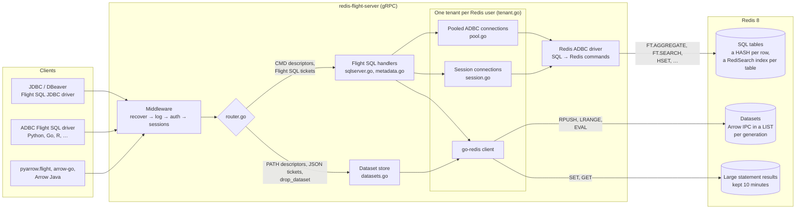
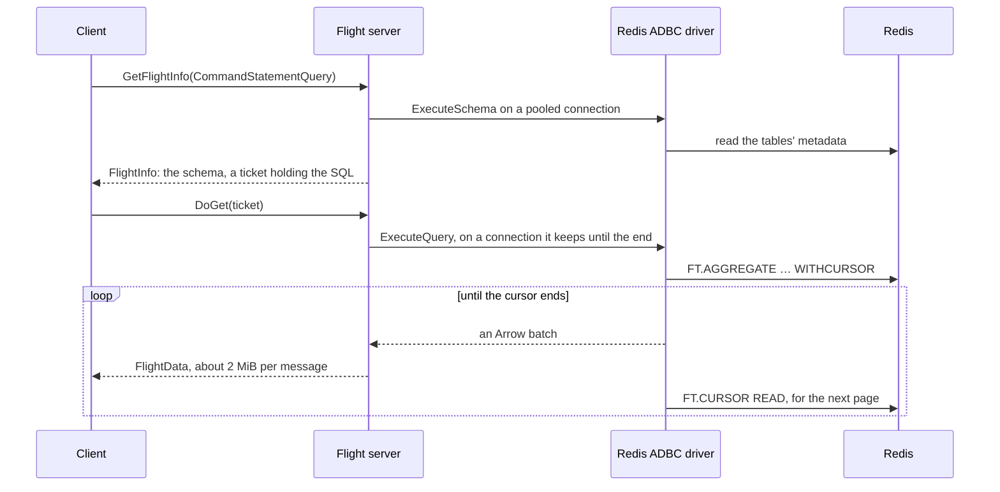
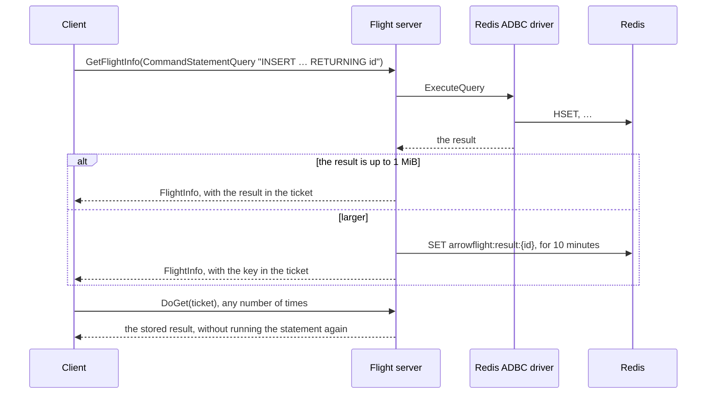
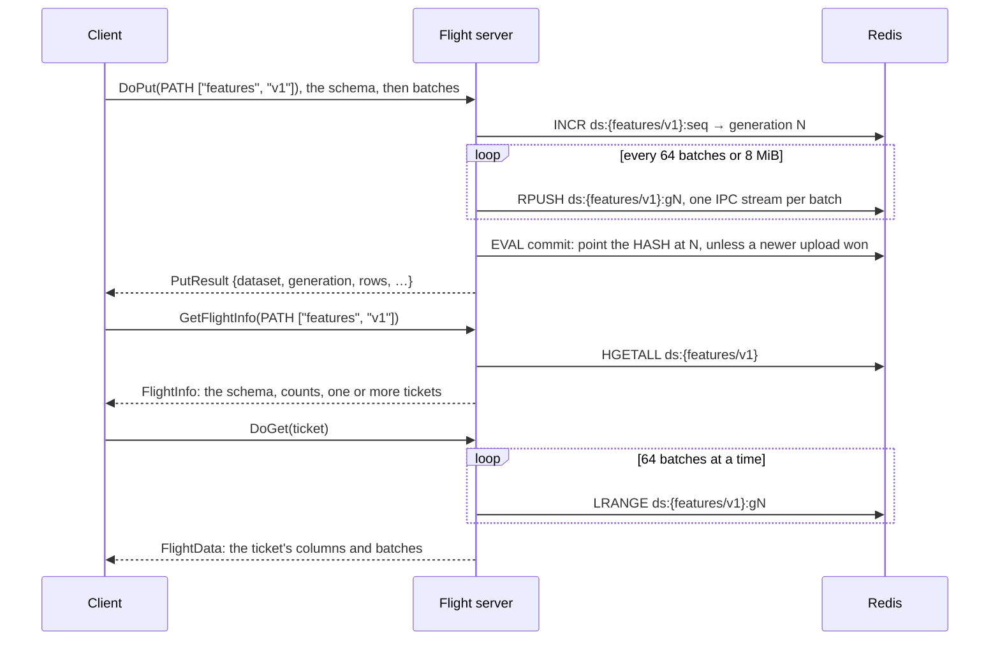
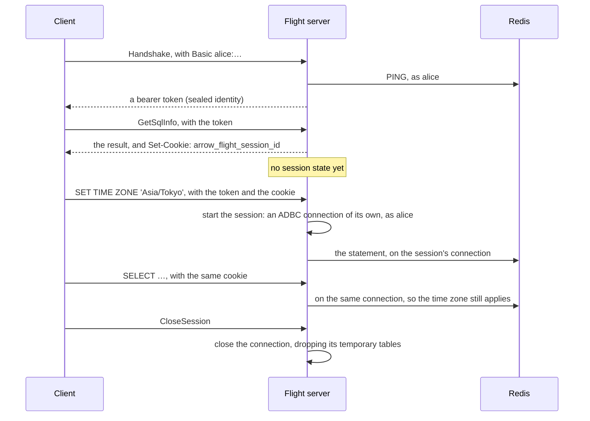

# Redis Arrow Flight server

A gRPC [Apache Arrow Flight](https://arrow.apache.org/docs/format/Flight.html)
and [Flight SQL](https://arrow.apache.org/docs/format/FlightSql.html) server
for Redis 8, written in Go. One endpoint serves two ways to move Arrow data in
and out of Redis:

| | **Flight SQL**, backed by the [Redis ADBC driver](https://github.com/alberttwong/redis-adbc-driver) | **Flight datasets**, stored as Arrow IPC |
|-|-|-|
| Requests | Flight SQL commands (`CMD` descriptors) | `PATH` descriptors, such as `["sales", "2026-10"]` |
| What you do | SQL: filters, `GROUP BY`, joins, windows, `INSERT` / `UPDATE` / `DELETE`, DDL, bulk ingest, catalog metadata | Upload a whole table by name, download it, list and drop |
| Storage in Redis | One HASH per row, plus a RediSearch index per table, so other Redis clients can read it too | The Arrow IPC bytes, unchanged |
| Arrow types | The SQL types (integers, floats, decimals, strings, binary, dates, times, timestamps, intervals) | Any type, including lists, structs, maps and dictionaries |
| Redis needed | The Query Engine (Redis 8, Redis Stack, Redis Cloud / Software with Search). Redis Flex is refused | Any Redis, including Flex and Cluster |
| Clients | ADBC Flight SQL driver (Python, Go, R, …), the Arrow Flight SQL JDBC driver | Any Flight client (`pyarrow.flight`, arrow-go, Arrow Java, …) |

## Which path to use

Use **Flight SQL** when you want the data to stay *queryable* in Redis: to
filter, aggregate, update rows, or let other applications read the HASHes.
Use **datasets** to *park and fetch whole tables* (dataframes, feature
snapshots, query results, ML batches) as fast as possible, or when your
data has types that SQL tables can't hold.

Measured with 100,000 rows × 4 columns, on an Apple Silicon laptop with Redis
8.6.2 in Docker, median of 3–5 runs:

| Operation | Flight SQL | Dataset |
|-|-:|-:|
| Write 100k rows (bulk ingest / DoPut) | 637 ms | 13 ms |
| Read all 100k rows (`SELECT *` / DoGet) | 515 ms | 22 ms |
| Filter + `GROUP BY` on indexed columns | 6.3 ms | not available |
| Point lookup (`WHERE order_id = 4242`) | 2.4 ms | not available |

Datasets are 25–50× faster for whole-table transfers, since nothing is
converted per row. A dataset read can pick columns and a range of batches,
but only SQL can filter rows by value. Both can be combined: for example,
upload a dataset, then bulk-ingest the rows you want to query into a SQL
table.

## Architecture



- **Middleware.** `auth` is there only with `--auth=redis-acl`, and `sessions`
  unless `--sessions=false`.
- **Tenants.** Each Redis user gets its own ADBC database, connection pool and
  go-redis client, so every command runs with that user's ACLs.
- **The router** tells the two paths apart by the descriptor type and the
  ticket's first byte (a protobuf `Any`, or `{`).
- **Code.** [Development](#development) lists what each file does.

### How a request flows

**A query** (`SELECT`, `SHOW`) is planned when its FlightInfo is requested,
and runs when its ticket is read:



A plain scan like this streams. A query whose result must be built whole
first (an aggregate, a join, a sort the driver does) reads every page
before the first batch is sent, and gives its connection back at once.

**A statement that changes something** (`INSERT`, `UPDATE`, DDL, `SET`, …)
runs when its FlightInfo is requested, so it runs exactly once. Its ticket
carries the result:



`CommandStatementUpdate` (DoPut) runs the statement and returns its row count
in the reply.

**A dataset** is written as a new generation, switched to atomically, and
read back in pages:



**Logging in and sessions.** With `--auth=redis-acl`, the handshake checks
the credentials against Redis. A client that keeps cookies gets a session,
with its own connection:



## Quick start

You need Go 1.26+, Docker and, for the Python example, [uv](https://docs.astral.sh/uv/).

```bash
docker compose up --detach --wait redis
```

```bash
make run
```

The server listens on `localhost:8815`. In another terminal, run the Python
tour (SQL with the ADBC Flight SQL driver, then datasets with
`pyarrow.flight`):

```bash
uv run examples/python/quickstart.py
```

To run Redis and the server together in Docker instead:

```bash
docker compose up --detach --build --wait
```

## Using it

### Flight SQL from Python (ADBC)

```python
import adbc_driver_flightsql.dbapi as flight_sql
import pyarrow as pa

with flight_sql.connect("grpc://localhost:8815", autocommit=True) as conn, conn.cursor() as cur:
    cur.adbc_ingest("orders", pa.table({"id": [1, 2, 3], "country": ["JPN", "USA", "JPN"]}), mode="replace")
    cur.execute("SELECT country, COUNT(*) AS n FROM orders WHERE id >= ? GROUP BY country", parameters=(2,))
    print(cur.fetch_arrow_table())
```

Pass `autocommit=True`: the driver runs every statement in autocommit mode.
The SQL dialect is the Redis ADBC driver's, which is close to PostgreSQL;
see its [Supported SQL](https://github.com/alberttwong/redis-adbc-driver#supported-sql).
Parameters may be written `?` or `$1`.

### Datasets from Python (pyarrow.flight)

```python
import json
import pyarrow as pa
import pyarrow.flight as flight

client = flight.connect("grpc://localhost:8815")
table = pa.table({"id": [1, 2], "embedding": [[0.1, 0.2], [0.3, 0.4]]})
desc = flight.FlightDescriptor.for_path("features", "v1")

writer, results = client.do_put(desc, table.schema)
writer.write_table(table)
writer.done_writing()
print(json.loads(results.read().to_pybytes()))  # {'dataset': 'features/v1', 'generation': 1, 'rows': 2, ...}
writer.close()

info = client.get_flight_info(desc)
print(pa.concat_tables([client.do_get(ep.ticket).read_all() for ep in info.endpoints]))

# Just the embedding column, of the first 10 batches.
ticket = flight.Ticket(json.dumps({"dataset": "features/v1", "columns": ["embedding"], "batches": [0, 10]}).encode())
print(client.do_get(ticket).read_all())

print([f.descriptor.path for f in client.list_flights(b"features/")])
list(client.do_action(flight.Action("drop_dataset", b"features/v1")))
```

Read every endpoint of a FlightInfo. A dataset has one unless the server runs
with `--dataset-endpoint-batches`.

### JDBC (DBeaver and others)

Use the [Arrow Flight SQL JDBC driver](https://arrow.apache.org/java/current/flight_sql_jdbc_driver.html)
(`org.apache.arrow:flight-sql-jdbc-driver`). Tested with 19.0.0 on Java 17 and
21. The URL is:

```text
jdbc:arrow-flight-sql://localhost:8815/?useEncryption=false
```

- **Logging in:** with `--auth=redis-acl`, add `&user=<redis user>&password=<…>`
  to the URL. The driver logs in with the Flight handshake and keeps the bearer
  token.
- **TLS:** use `useEncryption=true`, plus `trustStore` or
  `disableCertificateVerification` as needed.
- **Sessions:** the driver keeps cookies, so each JDBC connection is a
  [session](#sessions): `SET`, `search_path` and temporary tables last from one
  statement to the next. Query results in a session are built whole before
  they are sent, so JDBC doesn't get [streamed](#flight-sql-support)
  results yet.
- **Java 17 and later:** run the JVM with
  `--add-opens=java.base/java.nio=ALL-UNNAMED`. In DBeaver, add it to
  `dbeaver.ini`.

`examples/jdbc/JdbcSmoke.java` checks prepared statements with `?` parameters,
DatabaseMetaData (catalogs, schemas, tables, columns, table types, keys),
update counts and the session. CI runs it on every pull request:

```bash
make jdbc-smoke
```

That target downloads the jar into `bin/` (checking its SHA-1) and runs the
smoke test against a server on `localhost:8815`.

Known limits of the JDBC driver (19.0.0):
- **Statements without a result schema run as updates.** The driver treats a
  prepared statement that has none as an update, so it gets no rows back. The
  server leaves the schema out for two kinds of statement:
  - a script of several statements that changes something, such as
    `CREATE TABLE x …; SELECT … FROM x`
  - a statement whose result depends on a parameter of unknown type
    (`SELECT ?`)

  Run such a query as its own statement.
- **Untyped parameters accept only `null`.** A parameter whose type can't be
  inferred from its use is typed NULL.

### Other clients

- **Go:** `github.com/apache/arrow-go/v18/arrow/flight/flightsql` (`flightsql.NewClient`) for SQL, and
  `flight.NewClientWithMiddleware` for datasets. The integration tests in
  `server/integration_test.go` use both.

## Flight SQL support

| Feature | Support |
|-|-|
| Queries (`CommandStatementQuery`), updates (`CommandStatementUpdate`) | Yes. A statement without a row count (DDL, `SET`) reports 0 rows |
| Prepared statements, with parameters | Yes. The handle carries the SQL and the bound values, so the server keeps no state. Clients must use the handle a bind returns (`DoPutPreparedStatementResult`, Flight SQL's stateless prepared statements). arrow-go, the ADBC Flight SQL driver and the JDBC driver do, and are tested; a client that ignores it loses the bound values. The parameter schema gives each parameter the type it's used as (a compared column's, an `INSERT` target's, a `CAST`'s, …), as the Redis ADBC driver infers it, or NULL. Parameters for a query are limited to 1 MiB |
| Bulk ingest (`CommandStatementIngest`) | Yes: create, append, replace, create-or-append, and pass-through options such as `adbc.redis.ingest.index_columns`. Temporary tables (`temporary`, or the `pg_temp` schema) need a [session](#sessions). `adbc.ingest.*` options are refused: set the target and mode with the command's fields |
| `GetCatalogs`, `GetDbSchemas`, `GetTables` (with schemas), `GetTableTypes`, `GetSqlInfo` | Yes. The catalog is `redis`; schemas are key namespaces (`public` by default) |
| Primary and foreign keys | Empty results: the driver has no constraints |
| Sessions: `SetSessionOptions`, `GetSessionOptions`, `CloseSession` | Yes, for clients that keep cookies: see [Sessions](#sessions) |
| Transactions, savepoints, Substrait, `GetXdbcTypeInfo`, cancellation | No |

How statements run:

- **Read-only statements** (`SELECT`, `SHOW`) run when their ticket is read,
  so any server replica can serve the ticket.
- **Every other statement** (`INSERT`, `UPDATE`, DDL, `SET`, …) runs when its
  FlightInfo is requested, so it runs exactly once even if the client never
  reads the stream (DB-API cursors often don't) or reads it twice. The result,
  such as the rows of `INSERT … RETURNING`, travels in the ticket. If it is
  larger than 1 MiB, it is kept in Redis for 10 minutes instead.
- **Outside a [session](#sessions), each request uses a pooled ADBC
  connection.** Session state then doesn't carry over between requests.
  A statement that changes it (`SET`, `BEGIN`, `CREATE TEMP TABLE`, or a
  table or view created in `pg_temp`) works within its own script, for
  example `SET TIME ZONE 'Asia/Tokyo'; SELECT …`, and its connection is
  closed afterwards rather than reused.
- **Plain scans stream from Redis.** For a query that reads one table
  through its index, row by row (`SELECT * FROM t`, or a filter and
  `ORDER BY` the index can do), the driver reads the rows a cursor page at
  a time while they are sent. The server then holds about one batch of
  them, whatever the table's size. Other queries (aggregates, joins,
  `DISTINCT`, window functions, sorts the driver does) are built whole in
  memory first. The driver's
  [Streamed results](https://github.com/alberttwong/redis-adbc-driver#streamed-results)
  has the exact rules.
  - A streaming result keeps its pooled connection until it has been sent,
    or the client goes away. Each Redis user can have `--max-streams` (8)
    results streaming at once, but always fewer than `--pool-max-open`, so
    the user's other requests have a connection (with a pool of 1, nothing
    streams). Queries beyond that are read whole, as are queries in a
    [session](#sessions).
  - A streaming result also keeps a cursor open on its table's index.
    RediSearch allows an index `search-index-cursor-limit` open cursors
    (128 by default), and the driver reads every query through one, so at
    the limit every query on the table fails with `RESOURCE_EXHAUSTED`
    until some are closed; clients can retry. The limit is shared by every
    client of the index: other servers (replicas), other tools, and every
    Redis user. So each server streams at most `--max-table-streams` (32)
    results from one table at once, across all users, and reads the rest
    whole. With several replicas, keep their total under the limit, or
    raise `search-index-cursor-limit` in Redis (and then
    `--max-table-streams`).
  - A client that takes longer than `--stream-stall-timeout` (2 minutes) to
    read a batch gets a `DEADLINE_EXCEEDED` error instead of the rest, and
    the server stops reading from Redis. Redis deletes a cursor that isn't
    read for 5 minutes.
  - To read every result whole instead, pass
    `-adbc-option adbc.redis.stream_results=false`.
- **Batches are sent at about 2 MiB each,** under gRPC's default 4 MiB limit.

## Sessions

A session keeps a client's session state from one request to the next: `SET`
parameters such as `search_path` and `TimeZone`, and temporary tables and
views. The session has its own ADBC connection, opened by its first SQL
request.

- **They are cookie sessions.** A response to a request without a session
  cookie sets one, `arrow_flight_session_id`. A client that sends it back is
  in that session.
- **Which clients keep cookies:**
  - The Arrow Flight SQL JDBC driver does by default.
  - The ADBC Flight SQL driver does with
    `adbc.flight.sql.rpc.with_cookie_middleware=true`. Each ADBC connection is
    then its own session.
  - arrow-go clients do with `flight.NewCookieMiddleware()`.
- **What it costs.** The server keeps nothing for a cookie it hands out until
  a request brings it back, so clients that don't keep cookies cost nothing:
  they use the pool as before.
- **When a session starts.** It begins with the client's *second* request,
  the first one carrying the cookie. Make a cheap call first (for example
  `GetSqlInfo`) if the very first statement is a `SET`.
- **Session options** (`SetSessionOptions`, `GetSessionOptions`):

  | Option | Effect |
  |-|-|
  | `catalog` | Must be `redis` |
  | `schema` | Sets the current schema (`search_path`); the schema must exist |
  | `timezone` | Sets the session time zone, as `SET TIME ZONE` does |

  - Erasing an option goes back to its default.
  - An unknown name gets `INVALID_NAME`, and a bad value `INVALID_VALUE`.
  - SetSessionOptions starts a session if the request has none.
- **When a session ends.** `CloseSession` ends it: its connection closes, and
  its temporary tables are dropped. So does `--session-idle-timeout` (10
  minutes) without requests; a session made by SetSessionOptions whose cookie
  never came back closes after 30 seconds. A later request with the old cookie
  starts a new, empty session.
- **Ownership.** A session belongs to the Redis user that made it. With
  `--auth=redis-acl`, another user's request with the same cookie gets a
  session of its own.
- **Results are read whole.** A query result in a session is built in
  memory before it is sent, not [streamed](#flight-sql-support) from Redis.
  A streaming result would keep the session's connection busy until read, and
  clients such as JDBC run other statements while they read a result.
- **Several servers.** Sessions live in one server's memory. Route a client to
  the same server each time (sticky sessions on the load balancer).
- **Turning them off.** `--sessions=false` does so: no cookies, and every
  request uses the pool.

## Datasets

- **Name.** A dataset's name is its `PATH` descriptor's segments joined with
  `/`.
- **DoPut** stores the stream as the dataset's new *generation*, then switches
  to it atomically with a Lua script. Readers never see a half-written upload;
  generation numbers only go up, so of two uploads the one that started later
  wins. An older one that finishes last is replaced at once: its reply says
  `"superseded": true`, and its data expires after the grace period. The
  reply's app metadata is JSON: `dataset`, `generation`, `rows`, `batches`,
  `bytes`, `updated`, and `superseded` when set.
- **GetFlightInfo / GetSchema** return the schema, row and byte counts, and a
  ticket for the current generation. A ticket for a replaced generation keeps
  working for 5 minutes, so reads already under way finish.
- **DoGet** takes a ticket from GetFlightInfo, or one you write yourself. A
  ticket is JSON:

  | Field | Meaning |
  |-|-|
  | `dataset` | The name. Required |
  | `generation` | The generation to read. Leave it out for the current one |
  | `columns` | Read just these columns, in this order. A name the dataset doesn't have, or one given twice, is `InvalidArgument` |
  | `batches` | `[start, end]`: read the stored batches from `start` up to, not including, `end`, counting from 0. An `end` past the last batch reads to the last; `start` equal to `end` returns the schema alone. A negative `start`, or an `end` before `start`, is `InvalidArgument` |

  For example, `{"dataset": "features/v1"}` reads the current generation, and
  `{"dataset": "features/v1", "columns": ["id", "label"], "batches": [0, 4]}`
  reads two columns of its first four batches. The stored batches are the
  uploaded ones, split to about 2 MiB each; the PutResult and the FlightInfo's
  app metadata count them (`batches`).
- **Parallel reads.** With `--dataset-endpoint-batches=N`, GetFlightInfo,
  PollFlightInfo and ListFlights return one endpoint per N batches. Clients can
  read the endpoints in parallel, and must read them all; together, in order,
  they are the dataset (the FlightInfo says `ordered`). Without the flag there
  is one endpoint, since a client that reads only the first would miss data.
- **ListFlights** lists datasets; the criteria expression, if given, is a name
  prefix.
- **`drop_dataset` action** deletes a dataset. Its body is the name, or
  `{"dataset": "<name>"}`.
- **Expiry.** `--dataset-ttl` makes uploaded datasets expire.

Keys (the prefix is set with `--key-prefix`, default `arrowflight:`). Every
key of one dataset shares a hash tag, so on a Redis Cluster it lives in one
slot:

| Key | Type | Holds |
|-|-|-|
| `arrowflight:ds:{<name>}` | HASH | `gen`, `schema` (IPC), `rows`, `batches`, `bytes`, `updated` |
| `arrowflight:ds:{<name>}:g<N>` | LIST | Generation N: an IPC stream with the schema alone, then one IPC stream per batch (about 2 MiB each) |
| `arrowflight:ds:{<name>}:seq` | STRING | The last generation number. It never expires, not even with `--dataset-ttl` or a drop, so generation numbers never repeat |
| `arrowflight:result:{<id>}` | STRING | A statement result too big for its ticket (expires after 10 minutes) |

The name in a key is URL-path-escaped.

## Authentication and TLS

By default (`--auth=none`), every client runs with the credentials in
`--redis-uri`. In that mode, keep the server on a trusted network.

With `--auth=redis-acl`, clients log in with the Flight handshake and Basic
credentials, which are **a Redis ACL user's username and password**. The
server checks them against Redis and returns a bearer token, and each call
then runs as that Redis user. Redis's ACLs decide what each client may read
and change, for SQL and datasets alike.

```bash
./bin/redis-flight-server --auth redis-acl --token-secret "$(openssl rand -hex 32)" \
  --tls-cert server.crt --tls-key server.key
```

```python
flight_sql.connect("grpc+tls://host:8815", db_kwargs={"username": "alice", "password": "…"}, autocommit=True)
```

```python
client.authenticate_basic_token("alice", "…")  # pyarrow.flight: returns the header to send
```

- **Tokens** are sealed with AES-256-GCM using a key derived from
  `--token-secret`. They hold the identity and the Redis password, encrypted,
  and expire after `--token-ttl` (12h).
- **Several servers** that share the secret accept each other's tokens. A
  token secret and TLS are therefore what you need behind a load balancer.
  Without a secret, tokens last only until the server restarts.
- **ACL rules.** A user needs the commands the
  [Redis ADBC driver lists](https://github.com/alberttwong/redis-adbc-driver#server-requirements)
  for SQL. For datasets, it also needs the key pattern `~arrowflight:*` and
  these commands:
  - to write: `+incr +rpush +pexpire +persist +hset +unlink +del +eval +evalsha`
  - to read: `+hget +hgetall +llen +lrange +scan +get`

  A user with exactly the driver's commands plus these ran
  `examples/python/quickstart.py`. A read-only user (the driver's read-only
  list plus the read commands above) can query and read datasets. Its writes
  fail with `PermissionDenied`.

## Configuration

Every flag can also be set with the environment variable shown.

| Flag | Environment | Default | Meaning |
|-|-|-|-|
| `-listen` | `FLIGHT_LISTEN` | `localhost:8815` | Address to listen on |
| `-redis-uri` | `REDIS_URI` | `redis://localhost:6379/0` | `redis://[user:pass@]host:port/db`, or `rediss://` for TLS to Redis |
| `-auth` | `FLIGHT_AUTH` | `none` | `none` or `redis-acl` |
| `-token-secret` | `FLIGHT_TOKEN_SECRET` | random | Seals bearer tokens; share it between replicas |
| `-token-ttl` | `FLIGHT_TOKEN_TTL` | `12h` | Bearer token lifetime |
| `-tls-cert`, `-tls-key` | `FLIGHT_TLS_CERT`, `FLIGHT_TLS_KEY` | | PEM files; enable TLS |
| `-key-prefix` | `FLIGHT_KEY_PREFIX` | `arrowflight:` | Prefix of the server's own keys |
| `-dataset-ttl` | `FLIGHT_DATASET_TTL` | `0` (keep) | Expire uploaded datasets |
| `-dataset-endpoint-batches` | `FLIGHT_DATASET_ENDPOINT_BATCHES` | `0` (one endpoint) | Give a dataset's FlightInfo one endpoint per this many batches, for [parallel reads](#datasets) |
| `-pool-max-idle` | `FLIGHT_POOL_MAX_IDLE` | `8` | Idle ADBC connections kept per Redis user |
| `-pool-max-open` | `FLIGHT_POOL_MAX_OPEN` | `32` | ADBC connections in use at once per Redis user |
| `-max-streams` | `FLIGHT_MAX_STREAMS` | `8` | Query results a Redis user can have [streaming](#flight-sql-support) from Redis at once, at most `-pool-max-open` minus 1. Each keeps a connection; further queries are read whole first |
| `-max-table-streams` | `FLIGHT_MAX_TABLE_STREAMS` | `32` | Query results that can stream from one table at once, across all users. Each keeps a cursor on the table's index, which allows 128 across every client; further queries are read whole first |
| `-stream-stall-timeout` | `FLIGHT_STREAM_STALL_TIMEOUT` | `2m` | End a streaming result whose client takes longer than this to read a batch |
| `-sessions` | `FLIGHT_SESSIONS` | `true` | [Sessions](#sessions) for clients that keep cookies |
| `-session-idle-timeout` | `FLIGHT_SESSION_IDLE_TIMEOUT` | `10m` | Close a session after this long without requests |
| `-max-msg-size` | `FLIGHT_MAX_MSG_SIZE` | 64 MiB | Largest gRPC message accepted |
| `-adbc-option k=v` (repeatable) | `FLIGHT_ADBC_OPTIONS` (comma-separated) | | [Redis ADBC driver options](https://github.com/alberttwong/redis-adbc-driver#options), such as `adbc.redis.aggregate_pushdown=all`, `adbc.redis.default_schema=sales`, `adbc.redis.cluster=true` |
| `-log-level` | `FLIGHT_LOG_LEVEL` | `info` | `debug` logs every call |

The server connects to Redis when the first request arrives, not at startup.
Opening an ADBC connection takes several round trips, so connections are
pooled per Redis user. A user's connections are closed after 10 idle minutes.

## Development

Code layout:

| Path | What it is |
|-|-|
| `cmd/redis-flight-server` | The command |
| `server/router.go` | Sends `PATH` descriptors, JSON tickets and `drop_dataset` to the dataset store, and everything else to Flight SQL |
| `server/sqlserver.go`, `server/metadata.go` | Flight SQL on the ADBC driver |
| `server/datasets.go` | The Arrow IPC dataset store |
| `server/tenant.go`, `server/pool.go` | Each Redis user's ADBC database, connection pool and go-redis client |
| `server/session.go` | Sessions: the cookie middleware, each session's connection, and the session options |
| `server/auth.go` | Redis ACL login and tokens |

Tests:

```bash
make test
```

```bash
make test-integration
```

```bash
make test-cluster
```

`make test` runs the unit tests, which need no Redis.
`make test-integration` starts the compose Redis and runs every test with
`-race`; `make test-cluster` does the same on a 3-shard Redis Cluster in one
container (ports 7001–7003). They create, and remove, tables, keys and ACL
users named `it_flight_*`. To use another Redis, set `REDIS_URI`, or
`REDIS_PORT` for the compose one:

```bash
REDIS_URI=redis://localhost:6379/0 go test -count=1 ./...
```

GitHub Actions (`.github/workflows/test.yml`) runs on every pull request and
push to `main`:
- gofmt and `go vet`
- every test, on standalone Redis and on the 3-shard cluster
- a check that the binary is statically linked
- the Python quickstart against the Docker image

The driver dependency is pinned in `go.mod` with a `replace` to a commit of
`github.com/alberttwong/redis-adbc-driver/go`. To build against a local
checkout instead:

```bash
go mod edit -replace github.com/adbc-drivers/redis/go=../redis-adbc-driver/go
```
