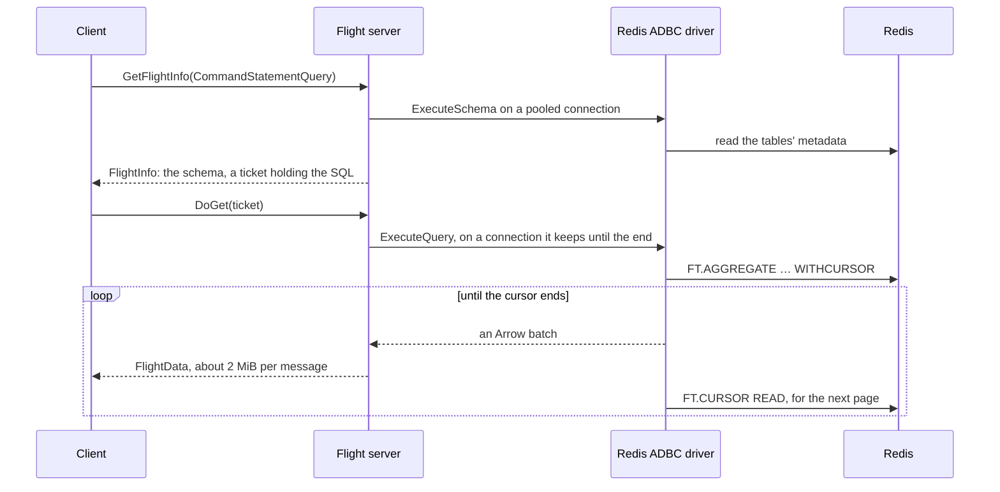
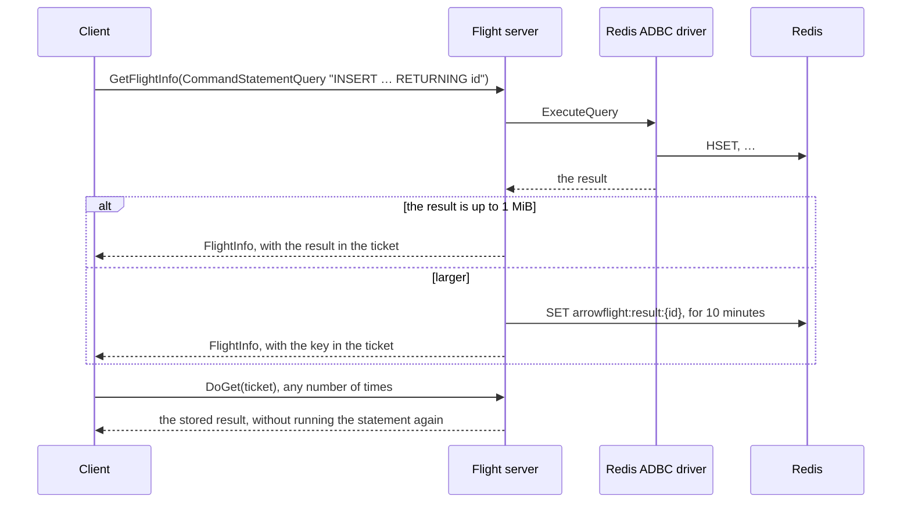
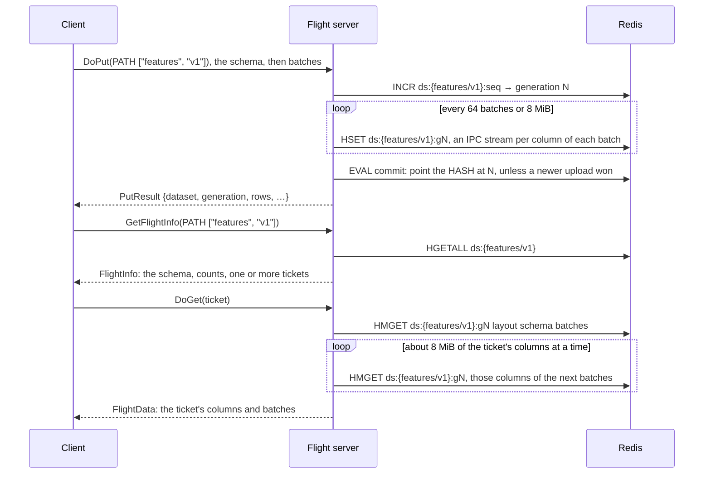
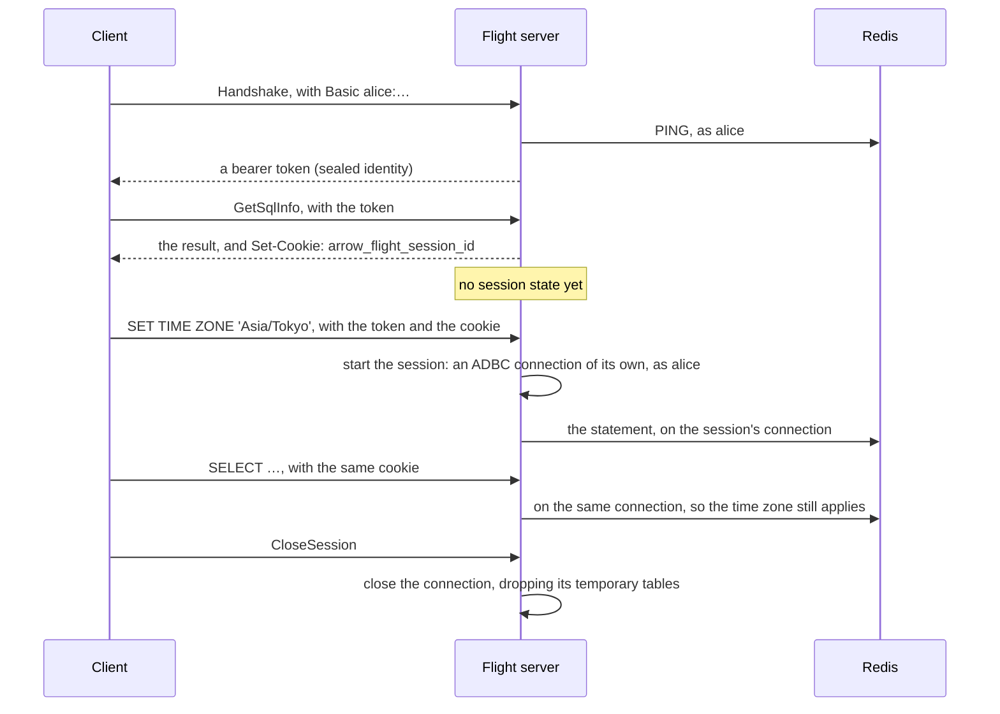

# Redis Arrow Flight server

Build profiles: this checkout builds **community** with paid-feature stubs.
Use an enterprise composition for TLS/authentication, monitoring, tuning and
automation. See [build profiles](docs/build-profiles.md) for exact availability.

A gRPC [Apache Arrow Flight](https://arrow.apache.org/docs/format/Flight.html)
and [Flight SQL](https://arrow.apache.org/docs/format/FlightSql.html) server
for Redis, written in Go. One endpoint serves two ways to move Arrow data in
and out of Redis:

| | **Flight SQL**, backed by the [Redis ADBC driver](https://github.com/redis/redis-adbc-driver) | **Flight datasets**, stored as Arrow IPC |
|-|-|-|
| Requests | Flight SQL commands (`CMD` descriptors) | `PATH` descriptors, such as `["sales", "2026-10"]` |
| What you do | SQL: filters, `GROUP BY`, joins, windows, `INSERT` / `UPDATE` / `DELETE`, DDL, bulk ingest, catalog metadata | Upload a whole table by name, download it, list and drop |
| Storage in Redis | One HASH per row, plus a RediSearch index per table, so other Redis clients can read it too | Arrow IPC streams encoded per column and batch |
| Arrow types | The SQL types (integers, floats, decimals, strings, binary, dates, times, timestamps, intervals) | Any type, including lists, structs, maps and dictionaries |
| Redis needed | The Query Engine (Redis 8, Redis Stack, Redis Cloud / Software with Search). Redis Flex is refused | Any Redis, including Flex and Cluster |
| Clients | ADBC Flight SQL driver (Python, Go, R, …), the Arrow Flight SQL JDBC driver | Any Flight client (`pyarrow.flight`, arrow-go, Arrow Java, …) |

## Quick start

You need Go 1.26.10 or newer, Docker and, for the Python example,
[uv](https://docs.astral.sh/uv/). For tagged builds, see [Install](#install).

```bash
docker compose up --detach --wait redis
```

```bash
make run
```

The server listens on `localhost:8815`. In another terminal, run the Python
tour (SQL with the ADBC Flight SQL driver, then datasets with
`pyarrow.flight`):

```bash
uv run examples/python/quickstart.py
```

To run Redis and the server together in Docker instead:

```bash
docker compose up --detach --build
```

Compose waits for Redis health before starting Flight. It does not establish
Flight readiness; do not use `--wait` with the community service, which has no
backend healthcheck.
Community health reports `UNKNOWN`; verify application readiness with a real SQL
query, as `scripts/wait-flight.py` does in CI. See [build profiles](docs/build-profiles.md).

### Install

Source builds download the pinned [public Redis ADBC driver](https://github.com/redis/redis-adbc-driver).
No GitHub token or private dependency secret is required for local, Docker,
or GitHub Actions builds. Run `make build` for a local binary, or `make docker`
for a container image. Public module downloads use Go checksum verification
and the checked-in `go.sum`.

The [release workflow](.github/workflows/release.yml) is configured to publish
static binaries for Linux (amd64, arm64) and macOS (arm64), with SHA-256
checksums, and a multi-arch image on the GitHub Container Registry. To use a
published [release](https://github.com/redis/redis-apache-arrow-flight/releases),
set `VERSION` to its tag and use these commands. If the release list is empty,
build from source with the [quick start](#quick-start).

```bash
curl -fsSL --remote-name-all https://github.com/redis/redis-apache-arrow-flight/releases/download/$VERSION/redis-flight-server-$VERSION-linux-amd64.tar.gz{,.sha256}
```

```bash
shasum -a 256 -c redis-flight-server-$VERSION-linux-amd64.tar.gz.sha256 && tar -xzf redis-flight-server-$VERSION-linux-amd64.tar.gz
```

```bash
docker run --rm -p 8815:8815 -e REDIS_URI=redis://host.docker.internal:6379/0 ghcr.io/redis/redis-apache-arrow-flight:${VERSION#v}
```

This container example uses Docker Desktop's `host.docker.internal` to reach
Redis on the host. With Docker Engine on Linux, put the image and Redis on a
shared Docker network and set `REDIS_URI` to Redis's name on that network.

Image tags are the version without the `v` (`1.2.3`), its minor version
(`1.2`) and `latest`; a prerelease (`1.2.3-rc1`) gets only its own.

## Contents

- [Choose an interface](#choose-an-interface) compares Flight SQL and datasets.
- [Data tools](#data-tools) lists compatible query, dataframe and inspection tools.
- [Client examples](#client-examples) covers Python, JDBC and Go.
- [Feature reference](#feature-reference) documents SQL, sessions and datasets.
- [Deployment and operations](#deployment-and-operations) covers security,
  configuration, health checks, metrics and shutdown.
- [Architecture](#architecture) explains routing, storage and request flow.
- [Development](#development) describes the code layout and test targets.
- [SDLC documentation](docs/sdlc/README.md) links project context, intent,
  specification, plan, review guidance, testing, and operations records.

See the [protocol capability matrix](docs/flight-capabilities.md) for supported commands, error behavior, and optional features.

## Choose an interface

Use **Flight SQL** when you want the data to stay *queryable* in Redis: to
filter, aggregate, update rows, or let other applications read the HASHes.
Use **datasets** to *park and fetch whole tables* (dataframes, feature
snapshots, query results, ML batches) as fast as possible, or when your
data has types that SQL tables can't hold.

Datasets avoid converting Arrow values to SQL rows. A dataset read can pick
columns (and fetch only those from Redis) and a range of batches, but only SQL
can filter rows by value. Both can be combined: for example, upload a dataset,
then bulk-ingest the rows you want to query into a SQL table. See the
[executable dataset-to-SQL workflow](docs/dataset-sql-workflow.md).

To measure dataset upload, full-read and one-column read performance on your
Redis, run the [100,000-row, 10-column benchmarks](server/dataset_bench_test.go):

```bash
REDIS_URI=redis://localhost:6379/0 go test ./server -run '^$' -bench Dataset -benchtime 10x
```

## Data tools

See the [versioned client validation matrix](docs/client-compatibility.md) for
checks actually run and known client limitations.

Use a **Flight SQL driver** to query SQL tables, or a **Flight client** to
upload and download named datasets. Tools that consume Arrow tables can
work with the results of either interface.

| Tool | How to use it with this project | Useful for |
|-|-|-|
| **DBeaver** | Configure the [Arrow Flight SQL JDBC driver](https://arrow.apache.org/java/current/flight_sql_jdbc_driver.html) with the URL below; see [JDBC setup](#jdbc-dbeaver-and-others) for JVM options, authentication and sessions | Interactive SQL, browsing schemas and tables, viewing query results |
| **Apache Superset** | Superset [requires a DB-API driver and SQLAlchemy dialect](https://superset.apache.org/user-docs/6.0.0/configuration/databases/). A candidate adapter is the third-party, beta [`sqlalchemy-adbc[flightsql]`](https://pypi.org/project/sqlalchemy-adbc/), using `adbc+flightsql://localhost:8815`; validate autocommit, metadata and generated SQL with this server | SQL exploration, charts and dashboards; requires adapter setup and compatibility testing |
| **Power BI** | Build a [custom ADBC-based Power Query connector](https://learn.microsoft.com/en-us/power-query/adbc) using the Flight SQL driver and server URI below; adapt the sample's type mappings, navigation queries and SQL generation to this server. This project does not ship a Power BI connector | Reports and dashboards; requires custom connector development and compatibility testing |
| **Tableau** | Try [Other Databases (JDBC)](https://help.tableau.com/current/pro/desktop/en-gb/examples_otherdatabases_jdbc.htm) with the Arrow Flight SQL JDBC driver and URL below; configure the [driver's JVM options](#jdbc-dbeaver-and-others) and validate metadata and generated SQL. Tableau's generic JDBC connector does not guarantee feature compatibility | Visual analysis and dashboards; requires driver setup and compatibility testing |
| **Other JDBC applications** | Load `org.apache.arrow:flight-sql-jdbc-driver` and use the same JDBC URL, if the application supports custom JDBC drivers | Java applications and data tools that allow a custom driver |
| **Python / PyArrow** | Use [ADBC Flight SQL](https://arrow.apache.org/adbc/current/driver/flight_sql.html) (`adbc_driver_flightsql`) for SQL and [`pyarrow.flight`](https://arrow.apache.org/docs/python/flight.html) for datasets; see [Client examples](#client-examples) | Queries, bulk ingest, Arrow table transfers and ML batches |
| **pandas** | Pass an ADBC Flight SQL connection to [`pd.read_sql`](https://pandas.pydata.org/docs/reference/api/pandas.read_sql.html) (pandas 2.2+), or convert a downloaded Arrow table with `table.to_pandas()` | Dataframe analysis and reporting |
| **Polars** | Pass an ADBC Flight SQL connection to [`pl.read_database`](https://docs.pola.rs/api/python/stable/reference/api/polars.read_database.html), or convert a downloaded Arrow table with `pl.from_arrow(table)` | Dataframe transformations and analytics |
| **DuckDB** | Fetch an Arrow table through ADBC or Flight, then [query it locally in DuckDB](https://duckdb.org/docs/current/guides/python/import_arrow); this uses an Arrow transfer rather than a direct DuckDB connection to the server | Joining Redis results with local files or other Arrow data |
| **R** | Use the [`adbcflightsql` driver](https://arrow.apache.org/adbc/current/driver/flight_sql.html) through the R ADBC packages, setting the server URI below | SQL queries and Arrow-based analysis in R |
| **Go / Arrow Java** | Use the Arrow Flight SQL client for SQL, or the Flight client for dataset `DoPut` / `DoGet`; see [Other clients](#other-clients) and the [Flight API](https://arrow.apache.org/docs/format/Flight.html) | Applications and data pipelines |
| **Redis Insight** | [Connect directly to the backing Redis database](https://redis.io/docs/latest/develop/tools/insight/), rather than the Flight endpoint | Inspecting SQL row HASHes, search indexes and Redis memory usage; dataset payloads remain encoded Arrow IPC |

Local connection addresses (without TLS):

```text
Flight / ADBC: grpc://localhost:8815
JDBC:          jdbc:arrow-flight-sql://localhost:8815/?useEncryption=false
```

The Python tour and Go integration tests exercise the Flight SQL and dataset
clients. The JDBC smoke test exercises the driver used by DBeaver. Superset,
Power BI and Tableau are integration options that require the setup and
compatibility testing described above; they have not been tested with this
project. The dataframe, DuckDB, R and Redis Insight workflows describe
compatible interfaces but are not covered by this project's integration tests.

For SQL, use autocommit: transactions are not supported. A tool's PostgreSQL
or generic Redis connector does not connect to the Flight endpoint; select
Flight SQL or install its driver. SQL tools see SQL tables, while named
datasets are accessed through Flight's dataset API.

## Client examples

### Flight SQL from Python (ADBC)

```python
import adbc_driver_flightsql.dbapi as flight_sql
import pyarrow as pa

with flight_sql.connect("grpc://localhost:8815", autocommit=True) as conn, conn.cursor() as cur:
    cur.adbc_ingest("orders", pa.table({"id": [1, 2, 3], "country": ["JPN", "USA", "JPN"]}), mode="replace")
    cur.execute("SELECT country, COUNT(*) AS n FROM orders WHERE id >= ? GROUP BY country", parameters=(2,))
    print(cur.fetch_arrow_table())
```

Pass `autocommit=True`: the driver runs every statement in autocommit mode.
The SQL dialect is the Redis ADBC driver's, which is close to PostgreSQL;
see its [Supported SQL](https://github.com/redis/redis-adbc-driver#supported-sql).
Parameters may be written `?` or `$1`.

### Datasets from Python (pyarrow.flight)

```python
import json
import pyarrow as pa
import pyarrow.flight as flight

client = flight.connect("grpc://localhost:8815")
table = pa.table({"id": [1, 2], "embedding": [[0.1, 0.2], [0.3, 0.4]]})
desc = flight.FlightDescriptor.for_path("features", "v1")

writer, results = client.do_put(desc, table.schema)
writer.write_table(table)
writer.done_writing()
print(json.loads(results.read().to_pybytes()))  # {'dataset': 'features/v1', 'generation': 1, 'rows': 2, ...}
writer.close()

info = client.get_flight_info(desc)
print(pa.concat_tables([client.do_get(ep.ticket).read_all() for ep in info.endpoints]))

# Just the embedding column, of the first 10 batches.
ticket = flight.Ticket(json.dumps({"dataset": "features/v1", "columns": ["embedding"], "batches": [0, 10]}).encode())
print(client.do_get(ticket).read_all())

print([f.descriptor.path for f in client.list_flights(b"features/")])
list(client.do_action(flight.Action("drop_dataset", b"features/v1")))
```

Read every endpoint of a FlightInfo. A dataset has one unless the server runs
with `--dataset-endpoint-batches`.

### JDBC (DBeaver and others)

Use the [Arrow Flight SQL JDBC driver](https://arrow.apache.org/java/current/flight_sql_jdbc_driver.html)
(`org.apache.arrow:flight-sql-jdbc-driver`). Tested with 19.0.0 on Java 17, 21
and 25. The URL is:

```text
jdbc:arrow-flight-sql://localhost:8815/?useEncryption=false
```

- **Logging in:** with `--auth=redis-acl`, add `&user=<redis user>&password=<…>`
  to the URL. The driver logs in with the Flight handshake and keeps the bearer
  token.
- **TLS:** use `useEncryption=true`, plus `trustStore` or
  `disableCertificateVerification` as needed.
- **Sessions:** the driver keeps cookies, so each JDBC connection is a
  [session](#sessions): `SET`, `search_path` and temporary tables last from one
  statement to the next. Plain scans [stream](#flight-sql-support) from Redis
  in a session too, so a `SELECT *` of a large table (DBeaver's data tab)
  isn't held in the server's memory, and the connection runs other
  statements while a `ResultSet` is read. A connection that has made a
  temporary table reads its results whole.
- **Browsing a large result:** a `ResultSet` left unread for longer than
  `--stream-stall-timeout` (2 minutes) fails on its next fetch. DBeaver
  fetches a page at a time as you scroll, so raise the timeout if people
  leave results open.
- **Java 17 and later:** run the JVM with
  `--add-opens=java.base/java.nio=ALL-UNNAMED`.
- **Java 23 and later:** also add `--sun-misc-unsafe-memory-access=allow`.
  Without it the driver fails before it connects, with an
  `ExceptionInInitializerError` in `DefaultAllocationManagerFactory`. Java 17
  to 22 don't know the option and refuse to start with it.
- **DBeaver:** add the options to `dbeaver.ini`, one per line after `-vmargs`
  (the second one only if DBeaver runs on Java 23 or later):

  ```text
  -vmargs
  --add-opens=java.base/java.nio=ALL-UNNAMED
  --sun-misc-unsafe-memory-access=allow
  ```

`examples/jdbc/JdbcSmoke.java` checks prepared statements with `?` parameters,
DatabaseMetaData (catalogs, schemas, tables, columns, table types, keys),
update counts and the session, including a 100,000-row result read while the
connection runs other statements. CI runs it on Java 17, 21 and 25 on every pull
request:

```bash
make jdbc-smoke
```

That target downloads the jar into `bin/` (checking its SHA-1) and runs the
smoke test against a server on `localhost:8815`, with the JVM options for the
`java` on the `PATH`. Pick another with `JAVA=/path/to/bin/java`, and another
server with `JDBC_URL=…`.

Known limits of the JDBC driver (19.0.0):
- **Statements without a result schema run as updates.** The driver treats a
  prepared statement that has none as an update, so it gets no rows back. The
  server leaves the schema out for two kinds of statement:
  - a script of several statements that changes something, such as
    `CREATE TABLE x …; SELECT … FROM x`
  - a statement whose result depends on a parameter of unknown type
    (`SELECT ?`)

  Run such a query as its own statement.
- **Untyped parameters accept only `null`.** A parameter whose type can't be
  inferred from its use is typed NULL.

### Other clients

- **Go:** `github.com/apache/arrow-go/v18/arrow/flight/flightsql` (`flightsql.NewClient`) for SQL, and
  `flight.NewClientWithMiddleware` for datasets. The integration tests in
  `server/integration_test.go` use both.

## Feature reference

### Flight SQL support

| Feature | Support |
|-|-|
| Queries (`CommandStatementQuery`), updates (`CommandStatementUpdate`) | Yes. A statement without a row count (DDL, `SET`) reports 0 rows |
| Prepared statements, with parameters | Yes. The handle carries the SQL and the bound values, so the server keeps no state. Clients must use the handle a bind returns (`DoPutPreparedStatementResult`, Flight SQL's stateless prepared statements). arrow-go, the ADBC Flight SQL driver and the JDBC driver do, and are tested; a client that ignores it loses the bound values. The parameter schema gives each parameter the type it's used as (a compared column's, an `INSERT` target's, a `CAST`'s, …), as the Redis ADBC driver infers it, or NULL. Parameters for a query are limited to 1 MiB |
| Bulk ingest (`CommandStatementIngest`) | Yes: create, append, replace, create-or-append, and pass-through options such as `adbc.redis.ingest.index_columns`. Temporary tables (`temporary`, or the `pg_temp` schema) need a [session](#sessions). `adbc.ingest.*` options are refused: set the target and mode with the command's fields |
| `GetCatalogs`, `GetDbSchemas`, `GetTables` (with schemas), `GetTableTypes`, `GetSqlInfo`, `GetXdbcTypeInfo` | Yes. The catalog is `redis`; schemas are key namespaces (`public` by default) |
| Primary and foreign keys | Empty results: the driver has no primary/foreign-key constraints |
| Sessions: `SetSessionOptions`, `GetSessionOptions`, `CloseSession` | Yes, for clients that keep cookies: see [Sessions](#sessions) |
| Explicit query cancellation | `CancelFlightInfo`; the deprecated Flight SQL `CancelQuery` is translated to it. Applies to read-only query tickets with cancellation metadata; see below |
| Transactions, savepoints, Substrait | No |

How statements run:

- **Read-only statements** (`SELECT`, `SHOW`) run when their ticket is read,
  so any server replica can serve the ticket.
- **Every other statement** (`INSERT`, `UPDATE`, DDL, `SET`, …) runs when its
  FlightInfo is requested, so it runs exactly once even if the client never
  reads the stream (DB-API cursors often don't) or reads it twice. The result,
  such as the rows of `INSERT … RETURNING`, travels in the ticket. If it is
  larger than 1 MiB, it is kept in Redis for 10 minutes instead.
- **Outside a [session](#sessions), each request uses a pooled ADBC
  connection.** Session state then doesn't carry over between requests.
  A statement that changes it (`SET`, `BEGIN`, `CREATE TEMP TABLE`, or a
  table or view created in `pg_temp`) works within its own script, for
  example `SET TIME ZONE 'Asia/Tokyo'; SELECT …`, and its connection is
  closed afterwards rather than reused.
- **Plain scans stream from Redis.** For a query that reads one table
  through its index, row by row (`SELECT * FROM t`, or a filter and
  `ORDER BY` the index can do), the driver reads the rows a cursor page at
  a time while they are sent. The server then holds about one batch of
  them, whatever the table's size. Other queries (aggregates, joins,
  `DISTINCT`, window functions, sorts the driver does) are built whole in
  memory first. The driver's
  [Streamed results](https://github.com/redis/redis-adbc-driver#streamed-results)
  has the exact rules.
  - A streaming result keeps its pooled connection until it has been sent,
    or the client goes away. Each Redis user can have `--max-streams` (8)
    results streaming at once, but always fewer than `--pool-max-open`, so
    the user's other requests have a connection (with a pool of 1, nothing
    streams). With `--auth=none`, every client is the same user. Queries
    beyond that are read whole (see below), as are queries in a
    [session](#sessions) that has made temporary tables or views.
  - A streaming result also keeps a cursor open on its table's index.
    RediSearch allows an index `search-index-cursor-limit` open cursors
    (128 by default), and the driver reads every query through one, so at
    the limit every query on the table fails with `RESOURCE_EXHAUSTED`
    until some are closed; clients can retry. The limit is shared by every
    client of the index: other servers (replicas), other tools, and every
    Redis user. So each server streams at most `--max-table-streams` (32)
    results from one table at once, across all users, and reads the rest
    whole.
  - On standalone Redis, the server also reads how many cursors the
    index has open (`FT.INFO`, at most once a second per table), counting
    every client, and stops streaming from the table once three quarters
    of `search-index-cursor-limit` are open. The last quarter is left for
    queries read whole and other clients' short reads. A raised limit is
    picked up by itself.
  - On a cluster, `FT.INFO` doesn't report the count, so with several
    replicas keep their total `--max-table-streams` under the limit, or
    raise `search-index-cursor-limit` in Redis (and then
    `--max-table-streams`).
  - Set `--stream-overflow=reject` (`FLIGHT_STREAM_OVERFLOW=reject`) to
    refuse an eligible scan with `RESOURCE_EXHAUSTED` before execution when
    no stream/cursor slot is available. Retry after a stream finishes. The
    default `buffer` preserves the behavior below. This option does not bound
    driver execution memory for joins, aggregates or other non-streaming queries.
  - A query that could stream but finds no stream free (past
    `--max-streams` or `--max-table-streams`, or with the index near its
    cursor limit) is read into memory before it is sent, and its
    connection and cursor are given back at once. Such results share
    `--result-memory` (1 GiB) across the server until they have been sent. One that doesn't fit fails with `RESOURCE_EXHAUSTED`
    as soon as it would go over, and clients can retry, or read fewer rows
    or columns.
  - A client that takes longer than `--stream-stall-timeout` (2 minutes) to
    read a batch gets a `DEADLINE_EXCEEDED` error instead of the rest, and
    the server stops reading from Redis. Redis deletes a cursor that isn't
    read for 5 minutes.
  - To read every result whole instead, pass
    `-adbc-option adbc.redis.stream_results=false`.
- **Batches are sent at about 2 MiB each,** under gRPC's default 4 MiB limit.

### Query cancellation

`CancelFlightInfo` cancels a pending read-only SQL ticket or all active reads
of it, including prepared-query tickets returned by GetFlightInfo. The legacy
Flight SQL `CancelQuery` action maps to the same implementation. Active
cancellation is cooperative: readers poll Redis every 250 ms, then cancel the
execution context and release their cursors, connections and retained results.
A completed query or already-executed write returns `NOT_CANCELLABLE`;
cancellation never rolls back an autocommitted write. A racing active read can
return `CANCELLING` until cleanup finishes. Partial data already sent may have
reached the client; `CANCELLED` means the result is incomplete.

Cancellation records live under `arrowflight:query:{<id>}` (or `-key-prefix`)
and contain an opaque identity digest and lifecycle state, with no SQL or bound
values. Newly issued cancellable tickets expire after 10 minutes without an
active reader; readers renew that lease. Expired/unknown records give
`NOT_FOUND`; another Redis identity gets `PERMISSION_DENIED`. Repeated
cancellation is safe. Legacy tickets still work without explicit cancellation.
With `--auth=none`, clients share one Redis identity and its cancellation scope.

The Redis identity needs EVAL/GET/SET permissions on the query-metadata
keys to create a cancellable ticket. If metadata creation is denied, SQL still
works with a non-cancellable ticket. Other Redis errors remain errors. For
multiple replicas, use the same Redis, key prefix and Redis identity; cancellation
state is shared there. This does not make cookie sessions portable.

### Sessions

A session keeps a client's session state from one request to the next: `SET`
parameters such as `search_path` and `TimeZone`, and temporary tables and
views. The session has its own ADBC connection, opened by its first SQL
request.

- **They are cookie sessions.** A response to a request without a session
  cookie sets one, `arrow_flight_session_id`. A client that sends it back is
  in that session.
- **Which clients keep cookies:**
  - The Arrow Flight SQL JDBC driver does by default.
  - The ADBC Flight SQL driver does with
    `adbc.flight.sql.rpc.with_cookie_middleware=true`. Each ADBC connection is
    then its own session.
  - arrow-go clients do with `flight.NewCookieMiddleware()`.
- **What it costs.** A freshly issued cookie reserves identity metadata for
  30 seconds, with at most 10,000 issued/active entries combined. No dedicated
  ADBC connection is opened until session SQL or options need one. Clients that
  do not return cookies continue to use the pool.
- **When a session starts.** It begins with the client's *second* request,
  the first one carrying the cookie. Make a cheap call first (for example
  `GetSqlInfo`) if the very first statement is a `SET`.
- **Session options** (`SetSessionOptions`, `GetSessionOptions`):

  | Option | Effect |
  |-|-|
  | `catalog` | Must be `redis` |
  | `schema` | Sets the current schema (`search_path`); the schema must exist |
  | `timezone` | Sets the session time zone, as `SET TIME ZONE` does |

  - Erasing an option goes back to its default.
  - An unknown name gets `INVALID_NAME`, and a bad value `INVALID_VALUE`.
  - SetSessionOptions starts a session if the request has none.
- **When a session ends.** `CloseSession` ends it: its connection closes, and
  its temporary tables are dropped. So does `--session-idle-timeout` (10
  minutes) without requests; a session made by SetSessionOptions whose cookie
  never came back closes after 30 seconds. A later request with the old cookie
  fails with `ABORTED` and receives a fresh cookie. Restore required options
  explicitly before retrying; the failed request was not executed.
- **Replica/restart behavior.** Use session affinity so every cookie-bearing
  request reaches its owning process. An unknown cookie (wrong replica,
  restart, expiry or CloseSession) returns `ABORTED` before executing the
  request and issues a fresh cookie. Reconnect to the owner, or explicitly
  recreate settings and temporary objects before retrying. Shared bearer-token
  secrets allow authentication across replicas; they do not share sessions.
- **Ownership.** A session belongs to the Redis user that made it. With
  `--auth=redis-acl`, another user's request with the same cookie gets a
  session of its own.
- **Plain scans stream.** A query that [streams](#flight-sql-support) from
  Redis outside a session does in a session too, on a pooled connection, so
  the session's own stays free for its other statements (clients such as
  JDBC run some while they read a result):
  - The pooled connection gets the session's current schema (`search_path`)
    and time zone, as they are when the query starts (`SET LOCAL`
    included): a `SET` while the result is read doesn't change it. Of the
    `SET` parameters, only these two change what a scan returns. The
    connection's own are put back before the pool reuses it.
  - It sees the session's writes, since every statement commits as it runs.
  - The session's streams count against `--max-streams` and
    `--max-table-streams` like any; past them, results are read whole within
    `--result-memory`.
  - A session isn't closed as idle while one of its results streams.
  - Once the session has made a temporary table or view (or ingested a
    temporary table), its results are read whole on its own connection
    until the session ends: temporary objects hide other tables' names,
    and only that connection sees them.
  - Other queries (aggregates, joins, `SHOW`, …) run on the session's
    connection, built whole as outside a session.
- **Several servers.** Sessions live in one server's memory. Route a client to
  the same server each time (sticky sessions on the load balancer).
- **Turning them off.** `--sessions=false` does so: no cookies, and every
  request uses the pool.

### Datasets

- **Name.** A dataset's name is its `PATH` descriptor's segments joined with
  `/`.
- **DoPut** stores the stream as the dataset's new *generation*, then switches
  to it atomically with a Lua script. Readers never see a half-written upload;
  generation numbers only go up, so of two uploads the one that started later
  wins. An older one that finishes last is replaced at once: its reply says
  `"superseded": true`, and its data expires after the grace period. The
  reply's app metadata is JSON: `dataset`, `generation`, `rows`, `batches`,
  `bytes`, `updated`, and `superseded` when set.
- **GetFlightInfo / GetSchema** return the schema, row and byte counts, and a
  ticket for the current generation. A ticket for a replaced generation keeps
  working for 5 minutes, so reads already under way finish.
- **DoGet** takes a ticket from GetFlightInfo, or one you write yourself. A
  ticket is JSON:

  | Field | Meaning |
  |-|-|
  | `dataset` | The name. Required |
  | `generation` | The generation to read. Leave it out for the current one |
  | `columns` | Read just these columns, in this order. A name the dataset doesn't have, or one given twice, is `InvalidArgument` |
  | `batches` | `[start, end]`: read the stored batches from `start` up to, not including, `end`, counting from 0. An `end` past the last batch reads to the last; `start` equal to `end` returns the schema alone. A negative `start`, or an `end` before `start`, is `InvalidArgument` |

  For example, `{"dataset": "features/v1"}` reads the current generation, and
  `{"dataset": "features/v1", "columns": ["id", "label"], "batches": [0, 4]}`
  reads two columns of its first four batches. The stored batches are the
  uploaded ones, split to about 2 MiB each; the PutResult and the FlightInfo's
  app metadata count them (`batches`). Each column of a batch is stored on
  its own, so a read takes only the ticket's columns from Redis. The
  [dataset benchmarks](server/dataset_bench_test.go) measure full and
  one-column reads. A read takes the columns about 8 MiB at a time (up to
  64 batches), so it holds about that much of the dataset, whatever its size.
- **Parallel reads.** With `--dataset-endpoint-batches=N`, GetFlightInfo,
  PollFlightInfo and ListFlights return one endpoint per N batches. Clients can
  read the endpoints in parallel, and must read them all; together, in order,
  they are the dataset (the FlightInfo says `ordered`). Without the flag there
  is one endpoint, since a client that reads only the first would miss data.
- **ListFlights** lists datasets; the criteria expression, if given, is a name
  prefix.
- **`drop_dataset` action** deletes a dataset. Its body is the name, or
  `{"dataset": "<name>"}`.
- **Expiry.** `--dataset-ttl` makes uploaded datasets expire.

Keys (the prefix is set with `--key-prefix`, default `arrowflight:`). Every
key of one dataset shares a hash tag, so on a Redis Cluster it lives in one
slot:

| Key | Type | Holds |
|-|-|-|
| `arrowflight:ds:{<name>}` | HASH | `gen`, `schema` (IPC), `rows`, `batches`, `bytes`, `updated` |
| `arrowflight:ds:{<name>}:g<N>` | HASH | Generation N, by column: `layout` (`2`); `schema`, an IPC stream with the schema alone; `batches`, the number of batches (written last, so a generation without it is an unfinished upload); and for each batch `b` (from 0), `<b>:rows`, its row count, and `<b>:<c>`, an IPC stream of its column `c` alone (counted from 0, in the schema's order) |
| `arrowflight:ds:{<name>}:g<N>` | LIST | A generation stored by an earlier server: an IPC stream with the schema alone, then one IPC stream per batch. It stays readable, but a read of some columns takes them all from Redis |
| `arrowflight:ds:{<name>}:seq` | STRING | The last generation number. It never expires, not even with `--dataset-ttl` or a drop, so generation numbers never repeat |
| `arrowflight:result:{<id>}` | STRING | A statement result too big for its ticket (expires after 10 minutes) |

The name in a key is URL-path-escaped.

Storing each column of a batch on its own can use more Redis memory than
storing batches whole, since each column of each batch is a separate value.

**Upgrading.** Servers before the HASH layout fail to read the generations
newer ones store (Redis answers their `LLEN` with `WRONGTYPE`), so upgrade
every replica before uploading again. Generations they stored stay readable
by newer servers; upload a dataset again to read its columns separately.
Commits and drops work across versions.

## Deployment and operations

### Authentication and TLS

By default (`--auth=none`), every client runs with the credentials in
`--redis-uri`. In that mode, keep the server on a trusted network.

With `--auth=redis-acl`, clients log in with the Flight handshake and Basic
credentials, which are **a Redis ACL user's username and password**. The
server checks them against Redis and returns a bearer token, and each call
then runs as that Redis user. Redis's ACLs decide what each client may read
and change, for SQL and datasets alike.

```bash
./bin/redis-flight-server --auth redis-acl --token-secret "$(openssl rand -hex 32)" \
  --tls-cert server.crt --tls-key server.key
```

```python
flight_sql.connect("grpc+tls://host:8815", db_kwargs={"username": "alice", "password": "…"}, autocommit=True)
```

```python
client.authenticate_basic_token("alice", "…")  # pyarrow.flight: returns the header to send
```

- **Tokens** are sealed with AES-256-GCM using a key derived from
  `--token-secret`. They hold the identity and the Redis password, encrypted,
  and expire after `--token-ttl` (12h).
- **Several servers** that share the secret accept each other's tokens. A
  token secret and TLS are therefore what you need behind a load balancer.
  Without a secret, tokens last only until the server restarts.
- **ACL rules.** A user needs the commands the
  [Redis ADBC driver lists](https://github.com/redis/redis-adbc-driver#server-requirements)
  for SQL. For datasets, it also needs the key pattern `~arrowflight:*` and
  these commands:
  - to write: `+incr +hset +pexpire +persist +unlink +del +eval +evalsha`
    (servers before the HASH layout also need `+rpush`)
  - to read: `+hget +hgetall +hmget +scan +get`, and `+llen +lrange` for
    generations stored by servers before the HASH layout

  A user with exactly the driver's commands plus these ran
  `examples/python/quickstart.py`. A read-only user (the driver's read-only
  list plus the read commands above) can query and read datasets. Its writes
  fail with `PermissionDenied`.
- **Health checks** need no login, so load balancers and probes can call
  them. They report whether the server serves and Redis answers its background
  PING; see [Health checks](#health-checks).

### Configuration

Every flag can also be set with the environment variable shown.

| Flag | Environment | Default | Meaning |
|-|-|-|-|
| `-listen` | `FLIGHT_LISTEN` | `localhost:8815` | Address to listen on |
| `-redis-uri` | `REDIS_URI` | `redis://localhost:6379/0` | `redis://[user:pass@]host:port/db`, or `rediss://` for TLS to Redis |
| `-auth` | `FLIGHT_AUTH` | `none` | `none` or `redis-acl` |
| `-token-secret` | `FLIGHT_TOKEN_SECRET` | random | Seals bearer tokens; share it between replicas |
| `-token-ttl` | `FLIGHT_TOKEN_TTL` | `12h` | Bearer token lifetime |
| `-tls-cert`, `-tls-key` | `FLIGHT_TLS_CERT`, `FLIGHT_TLS_KEY` | | PEM files; enable TLS |
| `-key-prefix` | `FLIGHT_KEY_PREFIX` | `arrowflight:` | Prefix of the server's own keys |
| `-dataset-ttl` | `FLIGHT_DATASET_TTL` | `0` (keep) | Expire uploaded datasets |
| `-dataset-endpoint-batches` | `FLIGHT_DATASET_ENDPOINT_BATCHES` | `0` (one endpoint) | Give a dataset's FlightInfo one endpoint per this many batches, for [parallel reads](#datasets) |
| `-pool-max-idle` | `FLIGHT_POOL_MAX_IDLE` | `8` | Idle ADBC connections kept per Redis user |
| `-pool-max-open` | `FLIGHT_POOL_MAX_OPEN` | `32` | ADBC connections in use at once per Redis user |
| `-stream-overflow` | `FLIGHT_STREAM_OVERFLOW` | `buffer` | When an eligible scan has no stream capacity: `buffer` within the result budget, or `reject` before execution with `RESOURCE_EXHAUSTED` |
| `-max-streams` | `FLIGHT_MAX_STREAMS` | `8` | Query results a Redis user can have [streaming](#flight-sql-support) from Redis at once, at most `-pool-max-open` minus 1. Each keeps a connection; further queries are read whole first, within `-result-memory` |
| `-max-table-streams` | `FLIGHT_MAX_TABLE_STREAMS` | `32` | Query results that can stream from one table at once, across all users. Each keeps a cursor on the table's index, which allows 128 across every client (on standalone Redis, streams also stop at three quarters of them open); further queries are read whole first, within `-result-memory` |
| `-result-memory` | `FLIGHT_RESULT_MEMORY` | 1 GiB | Bytes of memory that query results read whole for want of a stream may take at once, across the server. A result that doesn't fit fails with `RESOURCE_EXHAUSTED` |
| `-stream-stall-timeout` | `FLIGHT_STREAM_STALL_TIMEOUT` | `2m` | End a streaming result whose client takes longer than this to read a batch |
| `-sessions` | `FLIGHT_SESSIONS` | `true` | [Sessions](#sessions) for clients that keep cookies |
| `-session-idle-timeout` | `FLIGHT_SESSION_IDLE_TIMEOUT` | `10m` | Close a session after this long without requests |
| `-max-msg-size` | `FLIGHT_MAX_MSG_SIZE` | 64 MiB | Largest gRPC message accepted |
| `-shutdown-timeout` | `FLIGHT_SHUTDOWN_TIMEOUT` | `25s` | On SIGTERM or SIGINT, let running calls finish for this long, then [cancel them](#shutdown) |
| `-adbc-option k=v` (repeatable) | `FLIGHT_ADBC_OPTIONS` (comma-separated) | | [Redis ADBC driver options](https://github.com/redis/redis-adbc-driver#options), such as `adbc.redis.aggregate_pushdown=all`, `adbc.redis.default_schema=sales`, `adbc.redis.cluster=true` |
| `-metrics-listen` | `FLIGHT_METRICS_LISTEN` | off | Address to serve [Prometheus metrics](#metrics) on, at `/metrics` (plain HTTP, no auth) |
| `-log-level` | `FLIGHT_LOG_LEVEL` | `info` | `debug` logs every call but health checks |
| `-healthcheck` | | | Check the server at `-listen` with the [gRPC health service](#health-checks) and exit: 0 if it serves, 1 if not. Trusts only `-tls-cert` when that is set |
| `-version` | | | Print the version and exit |

The server starts pinging Redis for health checks at startup. It opens ADBC
connections when SQL requests arrive; opening one takes several round trips,
so connections are pooled per Redis user. A user's connections are closed after
10 idle minutes.

### Shutdown

On SIGTERM or SIGINT the server stops accepting calls and lets running
ones (uploads, query streams) finish for up to `--shutdown-timeout` (25s).
Then it cancels the rest, waits for them to release their connections and
cursors, closes the sessions (dropping their temporary tables) and the
Redis connections, and exits. A second signal exits at once.

Keep `--shutdown-timeout` under the time your platform waits before it
kills the process: Kubernetes' `terminationGracePeriodSeconds` is 30s by
default, and `compose.yaml` sets `stop_grace_period: 30s` (Docker's
default is 10s).

The server pings a connection that has been idle for a minute, and closes
it if the client doesn't answer within 20 seconds, so a client that has
vanished doesn't hold a call, a connection or a cursor until TCP gives up.

### Monitoring

#### Health checks

Backend health monitoring below requires enterprise. Community reports `UNKNOWN`,
which is not readiness, and its image and Compose service have no backend probe.

The server has the standard
[gRPC health service](https://github.com/grpc/grpc/blob/master/doc/health-checking.md)
(`grpc.health.v1.Health`), on the Flight port. Its calls need no
authentication, even with `--auth=redis-acl`, and aren't logged.

- **SERVING** while Redis answers a PING. The server pings every 5 seconds,
  on a connection of its own, so checks cost Redis nothing. With
  `--auth=redis-acl`, an authentication error counts as an answer (each
  client brings its own credentials). With `--auth=none` it doesn't, since
  every request uses the server's. On a cluster, the node in `--redis-uri`
  is pinged.
- **NOT_SERVING** while Redis doesn't answer, and from the start of a
  [shutdown](#shutdown).
- The service names are `""` (the server) and
  `arrow.flight.protocol.FlightService`.

`redis-flight-server -healthcheck` asks the server at `-listen` (an
all-interfaces address is checked on the loopback address) and exits 0 if
it serves, 1 if not. With `-tls-cert` it uses TLS and trusts only that
certificate. The Docker image's `HEALTHCHECK` and the compose service run
it; it reads the same environment variables as the server, not the
server's flags. Any gRPC health client works too, such as
[`grpc_health_probe`](https://github.com/grpc-ecosystem/grpc-health-probe):

```bash
grpc_health_probe -addr=localhost:8815
```

On Kubernetes, use a gRPC readiness probe, so a server whose Redis is down
gets no traffic, and a TCP liveness probe, so it isn't restarted for that:

```yaml
readinessProbe:
  grpc:
    port: 8815
livenessProbe:
  tcpSocket:
    port: 8815
```

The kubelet's gRPC probe doesn't do TLS. With TLS, use an `exec` probe that
runs `/redis-flight-server -healthcheck`.

#### Metrics

The metric series below require enterprise. Community `/metrics` returns HTTP 204
with an empty body.

With `--metrics-listen` (`FLIGHT_METRICS_LISTEN`), the server serves
[Prometheus](https://prometheus.io/) metrics at `/metrics` on that address.
It is off by default. The endpoint is plain HTTP without authentication, so
bind it to a private address; its labels never name a Redis user or a table.
`compose.yaml` serves it on `localhost:9815`.

```bash
curl -s localhost:9815/metrics | grep '^redis_flight_'
```

| Metric | Type | What it counts |
|-|-|-|
| `redis_flight_calls_total{method, code}` | counter | Calls finished, by method (`DoGet`, `GetFlightInfo`, …) and gRPC code. Health checks aren't counted |
| `redis_flight_call_duration_seconds{method}` | histogram | How long calls took. A `DoGet` or `DoPut` lasts until its stream ends, so it mostly measures the client |
| `redis_flight_queries_streamed_total` | counter | Query results [streamed](#flight-sql-support) from Redis |
| `redis_flight_queries_read_whole_total{reason}` | counter | Query results read whole into memory first, by why (below) |
| `redis_flight_query_streams_open` | gauge | Results streaming now, each holding a pooled connection and a cursor |
| `redis_flight_query_results_stalled_total` | counter | Results ended by `--stream-stall-timeout` |
| `redis_flight_result_memory_bytes` | gauge | Memory held by results read whole for want of a stream, counted against `--result-memory` |
| `redis_flight_result_memory_refusals_total` | counter | Results refused with `RESOURCE_EXHAUSTED` for not fitting in `--result-memory` |
| `redis_flight_index_cursor_limit_errors_total` | counter | Calls that failed because an index had no cursor left (`INDEX_CURSOR_LIMIT`) |
| `redis_flight_pool_connections{state}` | gauge | Pooled ADBC connections, across Redis users: `in_use` (including ones being opened) and `idle` |
| `redis_flight_pool_wait_seconds` | histogram | How long requests that found `--pool-max-open` connections in use waited for one. Its `_count` is how many waited |
| `redis_flight_session_connections` | gauge | ADBC connections of [sessions](#sessions), outside the pool |
| `redis_flight_sessions_open` | gauge | Sessions the server keeps (with sessions on) |
| `redis_flight_sessions_full_total` | counter | Requests that used the pool because the server had 10,000 sessions |
| `redis_flight_tenants_open` | gauge | Redis users with an ADBC database, a connection pool and a Redis client open |
| `redis_flight_dataset_rows_written_total`, `redis_flight_dataset_bytes_written_total` | counter | Rows and Arrow IPC bytes of [dataset](#datasets) uploads committed |
| `redis_flight_dataset_rows_read_total`, `redis_flight_dataset_bytes_read_total` | counter | Rows of datasets sent, and their bytes read from Redis (only the ticket's columns) |
| `redis_flight_redis_up` | gauge | 1 while Redis answers the [health check](#health-checks)'s PING |
| `redis_flight_build_info{version}` | gauge | Always 1; the label is the server's version |

The Prometheus client adds the Go runtime's (`go_*`: heap, goroutines, GC)
and the process's (`process_*`: CPU, memory, open files).

`reason` is one of:
- `query`: the driver doesn't stream the query (aggregates, joins, CTEs, …),
  or returned a small result whole
- `session`: a [session](#sessions) that has made temporary tables reads
  its results on its own connection
- `user_limit`: the Redis user had `--max-streams` results streaming (with
  `--auth=none`, every client is one user)
- `table_limit`: the table had `--max-table-streams`
- `index_cursors`: the table's index had three quarters of its cursors open

The limits worth an alert:

```text
rate(redis_flight_queries_read_whole_total{reason=~"user_limit|table_limit|index_cursors"}[5m]) > 0
histogram_quantile(0.99, rate(redis_flight_pool_wait_seconds_bucket[5m])) > 1
increase(redis_flight_index_cursor_limit_errors_total[5m]) > 0
increase(redis_flight_result_memory_refusals_total[5m]) > 0
```

An index out of cursors and a result over `--result-memory` are also logged
at warn level.

## Architecture


- **Middleware.** `auth` is there only with `--auth=redis-acl`, and `sessions`
  unless `--sessions=false`. [Health checks](#health-checks) bypass logging,
  metrics, authentication and sessions; panic recovery still applies.
- **Tenants.** Each Redis user gets its own ADBC database, connection pool and
  go-redis client, so every command runs with that user's ACLs.
- **The router** tells the two paths apart by the descriptor type and the
  ticket's first byte (a protobuf `Any`, or `{`).
- **Code.** [Development](#development) lists what each file does.

### How a request flows

**A query** (`SELECT`, `SHOW`) is planned when its FlightInfo is requested,
and runs when its ticket is read:



A plain scan like this streams. A query whose result must be built whole
first (an aggregate, a join, a sort the driver does) reads every page
before the first batch is sent, and gives its connection back at once.

**A statement that changes something** (`INSERT`, `UPDATE`, DDL, `SET`, …)
runs when its FlightInfo is requested, so it runs exactly once. Its ticket
carries the result:



`CommandStatementUpdate` (DoPut) runs the statement and returns its row count
in the reply.

**A dataset** is written as a new generation, switched to atomically, and
read back in pages:



**Logging in and sessions.** With `--auth=redis-acl`, the handshake checks
the credentials against Redis. A client that keeps cookies gets a session,
with its own connection:



## Development

Code layout:

| Path | What it is |
|-|-|
| `cmd/redis-flight-server` | The command |
| `server/router.go` | Sends `PATH` descriptors, JSON tickets and `drop_dataset` to the dataset store, and everything else to Flight SQL |
| `server/sqlserver.go`, `server/metadata.go` | Flight SQL on the ADBC driver |
| `server/datasets.go` | The Arrow IPC dataset store |
| `server/tenant.go`, `server/pool.go` | Each Redis user's ADBC database, connection pool and go-redis client |
| `server/session.go` | Sessions: the cookie middleware, each session's connection, and the session options |
| `server/auth.go` | Redis ACL login and tokens |
| `server/health.go`, `cmd/redis-flight-server/healthcheck.go` | The gRPC health service, and `-healthcheck` |
| `server/metrics.go` | The Prometheus metrics |

Tests:

```bash
make test
```

```bash
make test-integration
```

```bash
make test-cluster
```

`make test` runs the unit tests, which need no Redis.
`make test-integration` starts the compose Redis and runs every test with
`-race`; `make test-cluster` does the same on a 3-shard Redis Cluster in one
container (ports 7001–7003). They create, and remove, tables, keys and ACL
users named `it_flight_*`. To use another Redis, set `REDIS_URI`, or
`REDIS_PORT` for the compose one:

```bash
REDIS_URI=redis://localhost:6379/0 go test -count=1 ./...
```

GitHub Actions (`.github/workflows/test.yml`) runs on every pull request and
push to `main`:
- gofmt and `go vet`
- every test, on standalone Redis and on the 3-shard cluster
- a check that the binary is statically linked
- the Python quickstart against the Docker image
- the JDBC smoke test against it, on Java 17, 21 and 25
- a check that it serves metrics

Releases: push a tag `vX.Y.Z` (or `vX.Y.Z-rc1` for a prerelease). The
release workflow (`.github/workflows/release.yml`) runs the tests on it,
builds the binaries (`make dist`, which works locally too) and the image,
runs each binary on its own platform, then pushes the image and attaches the
binaries to the tag's GitHub release, making the release if there is none.
Run it by hand (`workflow_dispatch`) to rebuild an existing tag. A pull
request that changes it, the Dockerfile or the Makefile builds and checks
everything without publishing.

The driver dependency is pinned in `go.mod` with a `replace` to the
[v0.0.18 release](https://github.com/redis/redis-adbc-driver/releases/tag/v0.0.18)
of `github.com/redis/redis-adbc-driver/go` (commit `2f053d3affad`, recorded
as a Go pseudo-version). To build against a local checkout instead:

```bash
go mod edit -replace github.com/adbc-drivers/redis/go=../redis-adbc-driver/go
```

The [endpoint acceptance defaults](docs/endpoint-acceptance.md) define the
10,000-row local workload, reproducible measurements and proposed deployment
objectives. See the document for measured results and remaining validation.

Both Flight build profiles use the full Redis ADBC driver. The paid-feature
packaging rule applies to Flight-owned features only; see
[build profiles](docs/build-profiles.md).
